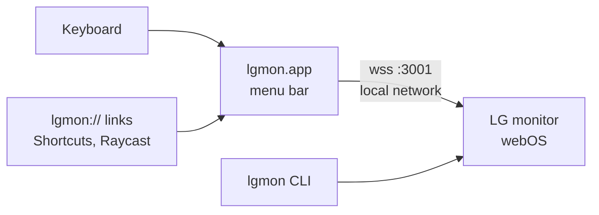

<p align="center">
  
</p>

<p align="center">
  <a href="https://github.com/davideconte/lgmon/releases/latest/download/lgmon.zip"></a>
</p>

<p align="center">
  
  
  
  
</p>

LG's **webOS smart monitors** (MyView, the smart UltraGear models and friends) are lovely, until you plug them into a Mac. The brightness keys do nothing, the volume is greyed out over HDMI, and the usual fixes (MonitorControl, Lunar, BetterDisplay, `m1ddc`) fail with `DDC communication failure`, because these monitors don't answer DDC/CI the way regular monitors do.

But they run webOS, and webOS listens on your network. **lgmon is a tiny native menu bar app that talks to the monitor the same way LG's own phone app does**: brightness, volume, inputs, apps, screen off. Over Wi-Fi or Ethernet, from your Mac's keyboard.

<table>
<tr>
<td width="58%" valign="top">

<p><b>Feels like part of macOS.</b> The brightness indicator is built like the system one: Liquid Glass, springs in from the top right corner, the level glides between values, percentage included.</p>
</td>
<td width="42%" valign="top">

<p><b>Menu bar.</b> Brightness and volume sliders, input switching, the monitor's apps, screen off, standby.</p>
</td>
</tr>
</table>

## Install

1. [**Download lgmon**](https://github.com/davideconte/lgmon/releases/latest/download/lgmon.zip), unzip, drag `lgmon.app` to Applications and open it. It's signed and notarized by Apple, so it opens like any other app.
2. Allow **Local Network** access when macOS asks: that's how lgmon finds and talks to the monitor.
3. **Accept the prompt on the monitor** with the remote or the joystick. One time only.
4. Allow **Accessibility** when asked, so lgmon can use the keyboard shortcuts (System Settings → Privacy & Security → Accessibility).

That's it. lgmon starts at login and lives in the menu bar as a small sun.

## Shortcuts

| Keys | What it does |
|---|---|
| <kbd>⌥</kbd> + volume up / down | Monitor brightness. Add <kbd>⇧</kbd> for fine steps |
| <kbd>⌃</kbd><kbd>⌥</kbd><kbd>↑</kbd> / <kbd>↓</kbd> | Monitor brightness, for keyboards without media keys |
| Brightness keys | Monitor brightness, when the pointer is on the LG screen (Apple keyboards) |
| Volume keys, mute | The monitor's speakers, when your Mac sends audio to it. macOS can't change the volume over HDMI or DisplayPort by itself |
| <kbd>⌃</kbd><kbd>⌥</kbd><kbd>↩</kbd> | Back to the Mac's input, after you switched input or opened a monitor app |

Each one can be turned off from **Settings** in the menu.

## Automation

lgmon answers to `lgmon://` links, so Shortcuts, Raycast, Alfred, Stream Deck or a shell script can drive the monitor:

```bash
open "lgmon://brightness/40"     # or +10, -10
open "lgmon://volume/-5"
open "lgmon://mute"
open "lgmon://input/HDMI_2"      # input id or label
open "lgmon://app/youtube"
open "lgmon://back"              # back to the Mac's input
open "lgmon://screen/off"        # any brightness change turns it back on
open "lgmon://standby"
open "lgmon://wake"              # Wake-on-LAN
open "lgmon://menu"
```

Prefer a terminal? There's also a small [command line tool](cli/) with the same features plus picture modes and on-screen notifications.

## Compatibility

Any LG monitor that runs **webOS** should work, since lgmon uses the standard webOS network API.

| Status | Models |
|---|---|
| ✅ Tested | **UltraGear 32G810SA** (webOS 24), MacBook Pro M3 Pro over HDMI |
| 🟡 Should work | MyView: 25SR50F, 27SR50F, 32SR50F, 32SR53FS, 27SR73U, 32SR70U, 32SR83U, 32SR85U · Smart Monitor: 32SQ730S, 32SQ780S, 43SQ700S, 32U889SA, 37U730SA, 27U511SA · Ultrawide / gaming: 34SR65QC, 34GX90SA, 39GX90SA, 45GX90SA |
| 🟡 Bonus | LG webOS **TVs** use the same API, so they work too |

Got one of the 🟡 models? [Open an issue](../../issues) with the result, success or not, and it moves to the tested row.

The app needs macOS 13 or later; on macOS 26 and later the indicator uses Liquid Glass, earlier versions get the classic blur.

## How it works



- **Discovery:** SSDP finds the monitor and remembers its IP and MAC. If DHCP gives it a new address, lgmon finds it again on its own.
- **Pairing:** the first connection asks for permission on the monitor; the key is stored in `~/.config/lgmon/`.
- **Brightness** is the panel's real backlight (`picture.backlight`), the same setting as the monitor's own menu, not a dimming overlay. webOS only lets you write it through its internal luna API, which lgmon reaches through the well-known alert trick.
- **One connection, kept open**, so a key press reaches the monitor in about a tenth of a second. Held keys are coalesced: only the latest value is sent.
- Built in Swift with AppKit, no dependencies. The webOS protocol details come from [bscpylgtv](https://github.com/chros73/bscpylgtv) and aiopylgtv (MIT), which also power the command line tool.

## Build from source

```bash
git clone https://github.com/davideconte/lgmon.git
cd lgmon/app && ./build.sh          # build/lgmon.app, signed with your Developer ID if you have one
```

`./build.sh --notarize` also notarizes, with `NOTARY_PROFILE` or an App Store Connect API key (`ASC_KEY_ID`, `ASC_ISSUER_ID`).

## Troubleshooting

<details>
<summary><b>"No LG webOS monitor found"</b></summary>

Mac and monitor must be on the same network and subnet, the monitor must be on, and lgmon needs **Local Network** permission (System Settings → Privacy & Security → Local Network). Some routers block multicast between Wi-Fi and Ethernet: in that case pin the IP once with the CLI, `lgmon use 192.168.x.y`, and the app will use it too.
</details>

<details>
<summary><b>No pairing prompt on the monitor</b></summary>

In the monitor's settings, look under *Network* or *General → Devices* for **LG Connect Apps** / **Mobile TV On** and turn it on. Then delete `~/.config/lgmon/keys.json` and choose **Settings → Search Monitors Again**.
</details>

<details>
<summary><b>Shortcuts don't do anything</b></summary>

Check that lgmon is enabled under System Settings → Privacy & Security → Accessibility (the menu shows *Enable Keyboard Shortcuts…* until it is). Also, many keyboards have no display brightness keys at all (on a Logitech MX Keys Mini, F1-F3 are the Easy-Switch keys), and vendor apps like Logi Options+ can swallow them: that's why <kbd>⌥</kbd> + volume keys exist.
</details>

<details>
<summary><b>Wake doesn't turn the monitor on</b></summary>

Wake-on-LAN needs the monitor's network to stay up in standby: enable **Turn on via Wi-Fi** / **Mobile TV On** in its settings.
</details>

<details>
<summary><b>Logs</b></summary>

`~/Library/Logs/lgmon.log`
</details>

## Why not DDC/CI?

DDC/CI is how MonitorControl and friends talk to monitors, through the video cable. On these webOS monitors it either isn't there or doesn't respond, and some Mac HDMI ports don't carry it at all. The network API is what LG's own app uses: it's on every webOS device and doesn't care about cables, ports or adapters.

## License

MIT. Not affiliated with LG Electronics. LG, webOS, UltraGear and MyView are trademarks of LG Electronics.
