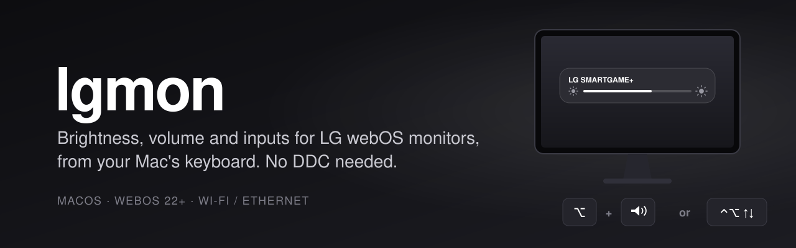
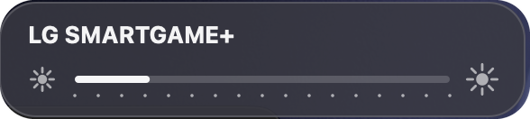
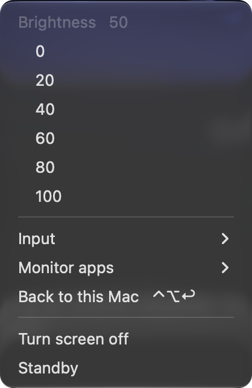
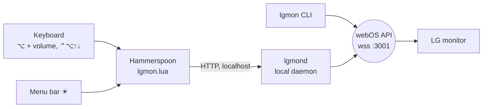

<p align="center">
  
</p>

<p align="center">
  
  
  
  
</p>

LG's **webOS smart monitors** (MyView, the smart UltraGear models and friends) are lovely, until you plug them into a Mac. The brightness keys do nothing, the volume is greyed out over HDMI, and the usual fixes (MonitorControl, Lunar, BetterDisplay, `m1ddc`) fail with `DDC communication failure`, because these monitors don't answer DDC/CI the way regular monitors do.

But they run webOS, and webOS listens on your network. **lgmon talks to the monitor the same way LG's own phone app does**: brightness, volume, inputs, apps, screen off. Over Wi-Fi or Ethernet, with your Mac's keyboard.

<table>
<tr>
<td width="62%" valign="top">

<p><b>Feels native.</b> The brightness indicator mimics the macOS panel, top right under the menu bar, and follows light and dark mode.</p>
</td>
<td width="38%" valign="top">

<p><b>Menu bar.</b> Brightness presets, input switching, the monitor's apps, screen off, standby.</p>
</td>
</tr>
</table>

## What you get

| | |
|---|---|
| **Brightness** | <kbd>⌥</kbd> + volume keys, or <kbd>⌃</kbd><kbd>⌥</kbd><kbd>↑</kbd> / <kbd>↓</kbd>. Add <kbd>⇧</kbd> for fine steps. Real brightness keys work too, when your keyboard has them. |
| **Volume** | When your Mac sends audio to the monitor, the volume and mute keys drive the monitor's speakers. macOS can't do that by itself over HDMI or DisplayPort. |
| **Inputs** | Switch between HDMI, DisplayPort and USB-C from the menu bar. <kbd>⌃</kbd><kbd>⌥</kbd><kbd>↩</kbd> brings you back to the Mac, even when the Mac is no longer on screen. |
| **Monitor apps** | Open YouTube, Netflix, Prime Video and the other webOS apps from the menu. |
| **Screen off** | Turns the panel off while music keeps playing through the speakers. Any brightness key wakes it. |
| **CLI** | Everything above and more from the terminal, scriptable. |

It's fast: a small local daemon keeps the connection open, so a key press reaches the monitor in about 0.1 s.

## Install

You need macOS, Python 3.9+ (the one that ships with the Xcode command line tools is fine) and [Hammerspoon](https://www.hammerspoon.org) for the keyboard part. Mac and monitor must be on the same network.

```bash
brew install --cask hammerspoon   # skip if you already have it
git clone https://github.com/davideconte/lgmon.git ~/lgmon
cd ~/lgmon && ./install.sh
```

The installer finds the monitor on your network and pairs with it. **A prompt appears on the monitor: accept it** with the remote or the joystick. Then it sets up the daemon and the Hammerspoon module. Give Hammerspoon Accessibility permission when macOS asks.

Only want the command line? `./install.sh --no-hotkeys`. To remove everything: `./uninstall.sh`.

## Command line

```console
$ lgmon
brightness 60  volume 21  input hdmi1

$ lgmon brightness 40         # or +10 / -10, alias: lgmon b
$ lgmon volume +5             # alias: lgmon v
$ lgmon mute

$ lgmon input
  DisplayPort_1  PC
* HDMI_1         Mac          connected
  HDMI_2         PC
  USB-C_1        PC
$ lgmon input usbc            # hdmi1, hdmi2, dp, usbc, or the label

$ lgmon screen off            # panel off, audio keeps going
$ lgmon off                   # standby
$ lgmon on                    # Wake-on-LAN back from standby

$ lgmon app youtube           # list with `lgmon app`
$ lgmon mode                  # picture mode; `lgmon mode game` to change it
$ lgmon notify "Render done"  # toast on the monitor

$ lgmon discover              # find webOS devices on the network
$ lgmon use 192.168.1.50      # pin one if you have several
```

## Compatibility

Any LG monitor that runs **webOS** should work, since lgmon uses the standard webOS network API.

| Status | Models |
|---|---|
| ✅ Tested | **UltraGear 32G810SA** (webOS 24), MacBook Pro M3 Pro over HDMI |
| 🟡 Should work | MyView: 25SR50F, 27SR50F, 32SR50F, 32SR53FS, 27SR73U, 32SR70U, 32SR83U, 32SR85U · Smart Monitor: 32SQ730S, 32SQ780S, 43SQ700S, 32U889SA, 37U730SA, 27U511SA · Ultrawide / gaming: 34SR65QC, 34GX90SA, 39GX90SA, 45GX90SA |
| 🟡 Bonus | LG webOS **TVs** use the same API, so they work too |

Got one of the 🟡 models? Run `lgmon` and [open an issue](../../issues) with the result, success or not, and it moves to the tested row.

What works may vary a little by webOS version: brightness, volume, mute, inputs and apps are basic calls every version has; `screen off` and `mode` depend more on the firmware.

## How it works



- **Discovery:** SSDP finds the monitor and remembers its IP and MAC. If DHCP gives it a new address, lgmon finds it again on its own.
- **Pairing:** the first connection asks for permission on the monitor; the key is stored in `~/.config/lgmon/`.
- **Brightness** is the panel's backlight (`picture.backlight`), the same setting as the monitor's own menu. Not a dimming overlay.
- **Daemon:** `lgmond` listens on `127.0.0.1:8765` only, keeps one connection open and serializes commands. Right after a write, webOS reports the old value for a moment, so the daemon trusts what it just set for a few seconds.
- Built on [bscpylgtv](https://github.com/chros73/bscpylgtv), the library behind Home Assistant's LG webOS integration.

## Configuration

Hammerspoon options go in `~/.hammerspoon/init.lua`:

```lua
lgmon = require("lgmon").start({
  brightnessStep = 5,                          -- per key press
  volumeStep = 2,
  brightnessUp = { { "ctrl", "alt" }, "up" },  -- set to false to disable
  brightnessDown = { { "ctrl", "alt" }, "down" },
  optionVolumeForBrightness = true,            -- ⌥ + volume keys = brightness
  volumeKeys = true,                           -- volume keys drive the monitor when audio goes to it
  backToMac = { { "ctrl", "alt" }, "return" },
  menubar = true,
  match = "LG",                                -- how the monitor shows up in macOS
})
```

Environment variables for the CLI and daemon: `LGMON_HOST` (fixed IP, skips discovery), `LGMON_CONFIG` (config folder), `LGMON_PORT` (daemon port).

## Troubleshooting

<details>
<summary><b>No device found</b></summary>

Mac and monitor must be on the same network and subnet, and the monitor must be on (not unplugged). Some routers block multicast between Wi-Fi and Ethernet: pin the IP with `lgmon use 192.168.x.y` (find it in the monitor's network settings).
</details>

<details>
<summary><b>No pairing prompt on the monitor</b></summary>

In the monitor's settings, look under *Network* or *General → Devices* for **LG Connect Apps** / **Mobile TV On** and turn it on. Then delete `~/.config/lgmon/key.sqlite` and run `lgmon` again.
</details>

<details>
<summary><b>My brightness keys do nothing</b></summary>

Many keyboards don't have display brightness keys at all (on a Logitech MX Keys Mini, F1-F3 are the Easy-Switch keys), and vendor apps like Logi Options+ can swallow them. That's why <kbd>⌥</kbd> + volume keys and <kbd>⌃</kbd><kbd>⌥</kbd><kbd>↑</kbd>/<kbd>↓</kbd> exist. Also check that Hammerspoon has Accessibility permission.
</details>

<details>
<summary><b><code>lgmon on</code> doesn't wake the monitor</b></summary>

Wake-on-LAN needs the monitor's network to stay up in standby: enable **Turn on via Wi-Fi** / **Mobile TV On** in its settings. Run `lgmon discover` once while the monitor is on, so lgmon learns its MAC address.
</details>

<details>
<summary><b>Logs</b></summary>

Daemon: `~/Library/Logs/lgmond.log`. Check it's running with `curl 127.0.0.1:8765/status`.
</details>

## Why not DDC/CI?

DDC/CI is how MonitorControl and friends talk to monitors, through the video cable. On these webOS monitors it either isn't there or doesn't respond, and some Mac HDMI ports don't carry DDC at all. The network API is what LG's own app uses, it's there on every webOS device, and it doesn't care about cables, ports or adapters.

## License

MIT. Not affiliated with LG Electronics. LG, webOS, UltraGear and MyView are trademarks of LG Electronics.
